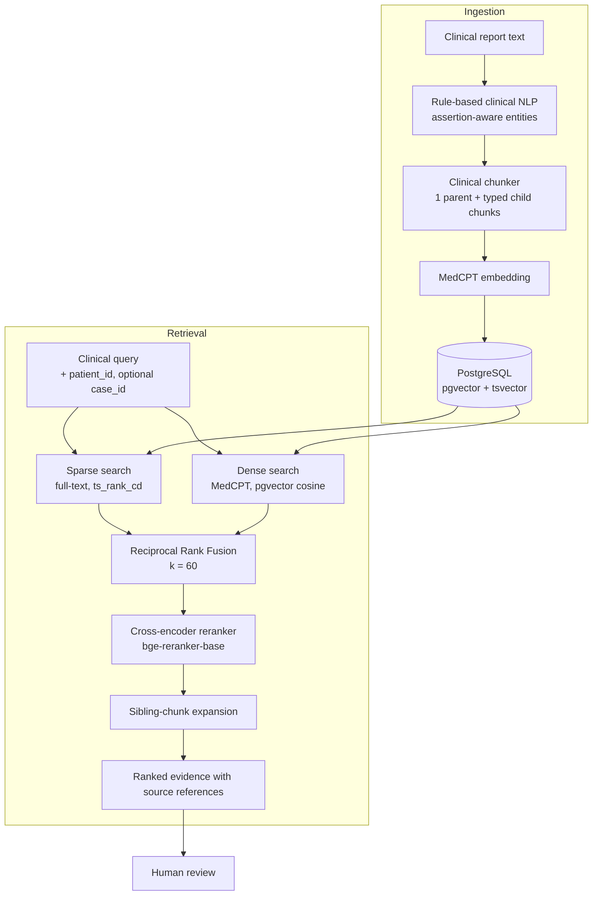

# MedFlow AI

**Medical report classification, clinical team assignment, and patient-specific clinical information retrieval (RAG).**

MedFlow AI is a human-supervised clinical documentation and case-management platform. It has two subsystems:

| Subsystem | Level | What it does |
|---|---|---|
| **A. Classification and team assignment** | Hospital | Classifies a report into a medical department (TF-IDF + calibrated SVM), ranks eligible clinical teams with a transparent weighted score, and records human approval or override in an audit log. |
| **B. Patient-specific retrieval (RAG)** | Doctor | Extracts assertion-aware facts from reports, splits them into typed clinical chunks, embeds them into pgvector, and retrieves evidence with hybrid search plus cross-encoder reranking, under strict patient and case isolation. |

> **Status:** decision-support prototype. Team data and retrieval results are synthetic and illustrative. All outputs are advisory and need human review. See [Limitations](#limitations).

---

## Tech stack

| Component | Technology |
|---|---|
| Backend | Python, FastAPI, SQLAlchemy, Alembic |
| Frontend | React, Vite, Tailwind CSS |
| Database | PostgreSQL |
| Vector search | pgvector (cosine distance) |
| Keyword search | PostgreSQL full-text search (`tsvector` + GIN) |
| Embeddings | MedCPT |
| Reranker | `BAAI/bge-reranker-base` (cross-encoder) |
| Classification | scikit-learn, TF-IDF, calibrated linear SVM |
| Security | JWT authentication, role-based access control (in progress) |

---

# How the RAG pipeline works

The goal is to let a doctor ask a question such as *"What are this patient's symptoms related to gallstones?"* and get back the right evidence, from **that patient's** records only, with a pointer to the source sentence.

The pipeline has four stages: **extract → chunk → embed and store → retrieve and rerank.**

## Stage 1: Rule-based clinical extraction

Before any chunking, a rule-based clinical NLP module turns raw text into structured facts. It uses medical terminology lists, regular expressions, contextual rules, and department-specific dictionaries.

- **Sentence reconstruction** rebuilds sentences broken by file extraction, handles medical abbreviations, and keeps **character offsets** for every sentence.
- **Sentence role classification** labels each sentence as a clinical finding, indication, treatment plan, missing-data statement, boilerplate, or heading. Only clinical findings feed entity extraction.
- **Entity extraction** covers symptoms, diagnoses, medications (with dose, route, frequency), procedures, investigations, vitals and lab values (with units and reference ranges), allergies, and past and family history.
- **Assertion detection** marks every mention as *present, absent, uncertain, historical, planned,* or *family*. It also extracts attributes such as severity, laterality, dates, and durations.
- **Evidence traceability:** each entity keeps its evidence text, sentence index, and character span, plus a `fact_id` that links equivalent facts across general and department-specific extraction.

**Why rules and not an LLM here?** The behaviour is deterministic and auditable, and every extracted fact points back to the exact source sentence. The trade-off is that rules can miss phrasing they have not seen.

## Stage 2: Clinical, hierarchical chunking

MedFlow AI uses **meaning-based, parent–child chunking** rather than fixed-size or sentence-based splitting.

**Why not fixed-size chunks?** A fixed window can cut a sentence in half or put a negated finding (*"no vomiting blood"*) next to an affirmed one. The retriever then cannot tell them apart, and a search for "vomiting blood" could return a patient who denied it. The chunker works on the **structured output of Stage 1**, not on raw text, and groups facts by clinical category **and** assertion status.

### Chunk hierarchy

| Level | Content | Role |
|---|---|---|
| **Parent chunk** | The complete original report | Context and traceability; the source of truth |
| **Child chunks** | Small, focused chunks, each linked to its parent | The units that are actually embedded and retrieved |

### Child chunk types

| Chunk type | Content | Why it is separate |
|---|---|---|
| Present symptoms | Confirmed symptoms with duration and severity | Positive findings stay apart from negated ones |
| Uncertain symptoms | Symptoms with unclear status | Possible symptoms are never shown as confirmed |
| Pertinent negatives | Denied symptoms, ruled-out diagnoses, negative exam findings | A search for "has X" never matches a patient who does not have X |
| Diagnoses | One chunk per assertion status | Confirmed and suspected diagnoses stay distinct |
| Family history | Conditions in relatives | A relative's disease is not read as the patient's own |
| Clinical history | The patient's own past history | Past history is separated from current findings |
| Vitals | Vital signs with measured values | Quick numeric lookup |
| Investigations | Tests **with actual results** | A test that was merely mentioned does not look like a finding |
| Medications | Current and documented medications | Treatment and interaction queries |
| Procedures and tests | Procedures; unconfirmed ones labelled "mention only" | Avoids implying a procedure was performed |
| Examination findings | Non-negative exam findings | Physical findings stay apart from history |
| Allergy status | NKDA, allergy present, conflicting, or unknown | **Always created**, so allergy status is never silently absent |
| Data gaps | Information missing from the report | Records that data was not supplied, without claiming it was not done |

### Chunking design principles

- **Assertion-aware separation.** Each chunk holds one clinical meaning with one polarity, stored as `retrieval_polarity` so retrieval can filter on it.
- **Patient scoping.** Every chunk carries the patient ID in its metadata, its text prefix, and its chunk ID. Chunks without a valid patient ID are rejected, and conflicting IDs reject the whole payload.
- **Missing is not negative.** Unknown allergy status is never converted to "no known allergies", and a missing report is never treated as "test not performed". Gaps go into a dedicated data-gap chunk.
- **Provenance.** Chunks keep fact IDs, entity IDs, and evidence spans, so every retrieved statement traces to its source sentence.
- **Determinism.** Chunk IDs are hash-based and namespaced by patient, report, and assertion. Re-chunking the same report gives the same IDs, and a collision never silently drops a chunk.
- **Human oversight.** Every chunk is flagged `requires_human_review`.

## Stage 3: Embedding and vector storage

- Each child chunk's text is embedded with **MedCPT**, a biomedical retrieval embedding model, so clinically related wording can match even without shared keywords (for example *abdominal pain* and *stomach discomfort*).
- The vector is stored in **PostgreSQL with pgvector**, in the same row as the chunk text, a `tsvector` column for keyword search, and its metadata: patient, case, and report IDs, chunk type, parent relationship, assertion information, and evidence references.
- Because vectors and metadata live together, similarity search can be combined with ordinary SQL filters (for example `patient_id = ...`) in a single query, and no separate vector database is needed.
- The pipeline validates inputs and vector dimensions, handles empty inputs and embedding or database failures explicitly, and records the embedding model and version for reproducibility.
- The same embedding model must be used for ingestion and for queries. Mixing models or dimensions produces invalid results.

## Stage 4: Hybrid retrieval and reranking

A query goes through four steps, all under the same patient and case filter.

| Step | Method | Role |
|---|---|---|
| 1. Sparse retrieval | PostgreSQL `tsvector` + GIN index, `websearch_to_tsquery`, ranked with `ts_rank_cd` | Exact and lexical matches: drug names, numbers, specific terms |
| 2. Dense retrieval | MedCPT query embedding, pgvector `<=>` cosine distance, similarity = 1 − distance | Semantic matches and paraphrases |
| 3. Fusion | Reciprocal Rank Fusion, `score = Σ 1 / (60 + rank)`, deduplicated by `chunk_id` | Merge both ranked lists without needing comparable scores |
| 4. Reranking | `BAAI/bge-reranker-base` cross-encoder | Re-score each (query, chunk) pair jointly for the final order |

After reranking, **sibling-chunk expansion** adds other chunks from the same patient and case as the top hits. This matters for questions that need evidence from several chunks, such as a diagnosis chunk plus a symptom chunk.

**Why hybrid?**
Dense search handles paraphrase but is weaker on exact medication names, numbers, and negation. Sparse search is precise on exact terms but misses different wording. RRF combines the two using ranks only, so it does not need to normalise a cosine similarity against a `ts_rank_cd` score.

**Why a cross-encoder on top?**
The first two stages score the query and chunk independently. A cross-encoder reads them together, which is slower but better at separating a truly relevant chunk from a similar-sounding irrelevant one. It only runs on a small candidate set, so latency stays acceptable.

**Defaults:** 20 candidates per method, `k = 60`, five final candidates. Each result keeps its sparse rank and score, dense rank and score, RRF score, `reranker_score`, and `reranker_rank`. None of these scores is a probability or a measure of clinical correctness.

### Patient and case isolation

Isolation is the core safety requirement of the retrieval layer.

- Both the dense and sparse SQL queries filter on `patient_id`, with an optional `case_id`.
- The hybrid service re-validates returned patient and case IDs before merging.
- The user query is passed as a bound parameter, which prevents SQL injection.
- These checks **do not replace API-level authorization.** The API layer must independently verify that the authenticated user may access the requested patient and case.

### Generation and human review

Retrieved chunks are the evidence passed to any downstream summarisation or documentation step. A well-behaved generation stage should use the chunks as evidence, avoid inventing missing patient details, say when evidence is insufficient, keep generated text distinguishable from the original report, and let users verify claims against the source. RAG reduces dependence on unsupported model recall but does not guarantee accuracy.

## Retrieval evaluation (illustrative)

Evaluated on a small **synthetic** corpus (3 patients, 2 cases) with labelled relevant chunks. Questions needed evidence from more than one chunk. Each row adds one stage to the previous one.

| Stage | Recall@5 | Recall@10 | MRR@10 | nDCG@10 | Isolation violations | Latency |
|---|---:|---:|---:|---:|---:|---:|
| Sparse AND (baseline) | 0.42 | 0.55 | 0.49 | 0.45 | 0 | 18 ms |
| Sparse OR | 0.68 | 0.81 | 0.62 | 0.64 | 0 | 21 ms |
| Dense (MedCPT) | 0.73 | 0.85 | 0.70 | 0.71 | 0 | 46 ms |
| Hybrid RRF | 0.83 | 0.93 | 0.77 | 0.80 | 0 | 59 ms |
| + Cross-encoder | 0.89 | 0.96 | 0.87 | 0.90 | 0 | 188 ms |
| + Sibling expansion | 0.94 | 0.99 | 0.89 | 0.92 | 0 | 206 ms |

What each step taught:

- **Sparse AND** fails cross-chunk questions, because all terms must sit in one chunk.
- **Sparse OR** gave the largest single recall gain. PostgreSQL full-text search has no IDF weighting, so generic words ("symptom", "patient") add noise. A small domain stoplist raised nDCG@10 from 0.76 to 0.82 with no recall loss.
- **Hybrid RRF** beat dense-only (Recall@5 0.73 → 0.83).
- **Cross-encoder** mainly improved ranking quality (MRR@10 0.77 → 0.87) at the cost of about 130 ms.
- **Sibling expansion** improved Recall@5 from 0.89 to 0.94 (average context 5.0 → 5.8 chunks) and should be capped to avoid context bloat.
- **Tuning:** `k = 60` was the balanced RRF default. A candidate pool beyond 50 added little for its latency cost.
- **Isolation:** zero violations at every stage across patient, case, empty-patient, nonexistent-patient, whitespace, and SQL-injection tests.

> These numbers come from a small synthetic set and must be replaced with logged results on real labelled data before being presented as measured performance.

---

# Department classification and team recommendation

### Classification

- TF-IDF features (10,000-feature cap) with a calibrated linear SVM, exported as `medflow_svm_calibrated_model.pkl`.
- Deployed categories: Cardiovascular / Pulmonary, Consult - History and Phy., Gastroenterology, Orthopedic, Radiology.
- The experimental six-class model (adds General Medicine) reached **82.58% test accuracy** and macro-F1 0.82 on 1,548 reports. The deployed five-class model is a separate artifact and needs its own evaluation.
- Prediction confidence is used to flag cases for extra human review. It is not a guarantee of clinical correctness.

### Team recommendation

After classification, eligible teams are ranked with a weighted score. Inactive, unavailable, on-leave, or at-capacity teams are excluded, and up to three recommendations are returned. Staff make the final decision.

| Factor | Weight |
|---|---:|
| Specialization match | 30% |
| Workload | 20% |
| Availability | 15% |
| Experience | 15% |
| Historical success | 15% |
| Emergency capability | 5% |

### Human-in-the-loop and audit

Authorised staff approve or override recommendations, and every approval, override, and status change is written to `audit_logs`.

---

# Data model

PostgreSQL is the system of record. Core tables: `departments`, `clinical_teams`, `team_performance`, `cases`, `predictions`, `recommendations`, `assignments`, `audit_logs`. Clinical chunks live in `clinical_chunks`, with text, embedding, `search_vector`, and the metadata described above.

# Security and responsible use

- Authentication (JWT) and role-based authorization.
- Patient and document access restrictions enforced at the API layer, not only in SQL.
- Secure handling of uploaded reports and credentials.
- Logging and error handling that do not leak clinical content.
- Traceability of generated content and key workflow decisions.
- Human review of all AI-generated documentation and recommendations.

# Limitations

- Clinical team data is synthetic, and the scoring weights are uncalibrated design choices.
- Classification metrics come from the six-class experimental model, not the deployed five-class one.
- Retrieval results come from a small synthetic corpus.
- Rule-based extraction can miss unseen phrasing. Negation and family-history boundaries need real-world evaluation.
- Sibling expansion is implemented. Parent-chunk expansion is future work.

# Current status

**Done:** PostgreSQL schema and models, calibrated SVM prediction service, case-centred prediction persistence, weighted team recommendation, human approval and override with audit logging, and the retrieval pipeline described above (extraction, chunking, embedding, hybrid retrieval, reranking, sibling expansion).

**Remaining:** complete and verify authentication and RBAC, end-to-end RAG integration testing, evaluation on real labelled data, stronger failure handling and automated tests, and frontend integration.

# Disclaimer

MedFlow AI is an academic and software-engineering project. It is not a substitute for professional medical judgment, validated clinical protocols, or authorised healthcare decisions. Generated content and recommendations require human oversight before clinical use.****
